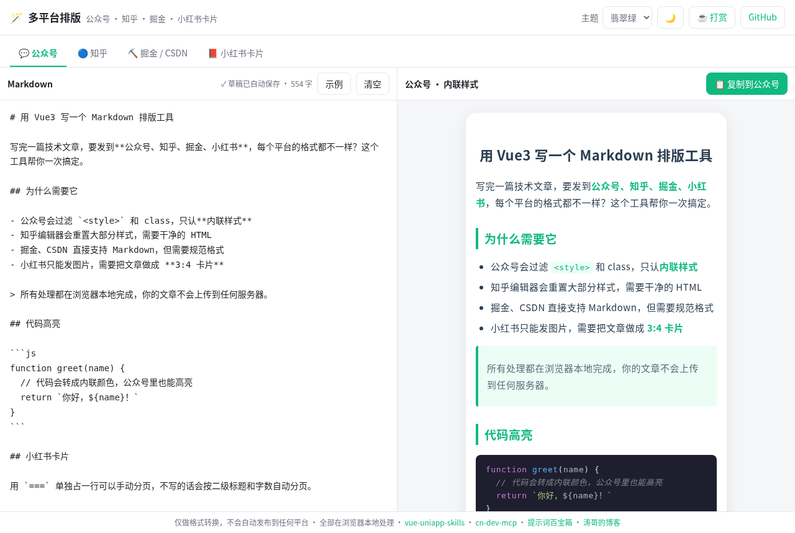
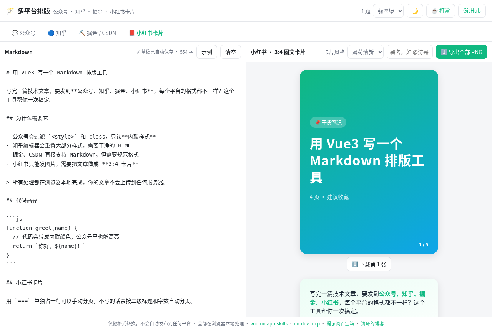
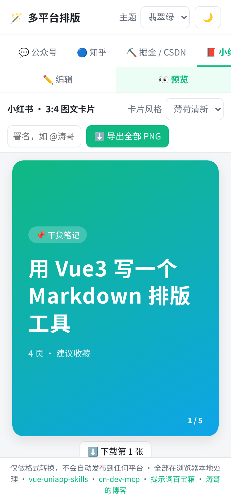

<div align="center">

# 🪄 md-multi-format · 多平台 Markdown 排版

**写一次 Markdown，一键复制到公众号、知乎、掘金、CSDN，还能生成小红书 3:4 图文卡片**

[在线使用](https://msnan.github.io/md-multi-format/) · 纯本地运行，文章不会上传到任何服务器

  

</div>



## 为什么做这个

技术博主写完一篇文章，往往要发好几个平台，但每个平台对格式的要求都不一样：

| 平台 | 要求 | 本工具的处理 |
| --- | --- | --- |
| 💬 公众号 | 会过滤 `<style>` 和 class，只认内联样式；正文外链不能点击 | 所有样式写成**内联 style**，代码高亮转成内联颜色，外链自动转成**文末脚注**（同一地址只编号一次，正文直接写出的网址不重复加脚注），代码块保留缩进和对齐空格 |
| 🔵 知乎 | 编辑器会重置大部分样式 | 输出**干净的语义化 HTML**，代码块保留语言标记 |
| ⛏️ 掘金 / CSDN | 直接支持 Markdown | 输出**规范化的 Markdown**：中英文之间加空格、标题补空格、代码块补语言、去掉 front matter、合并多余空行 |
| 📕 小红书 | 只能发图片 | 自动拆分成 **3:4 图文卡片**，导出 1080×1440 PNG，可以单张下载或打包成 zip |

## 小红书卡片 ⭐

这是本工具和其他公众号排版器最大的不同。



- 一级标题 `#` 自动生成**封面卡**
- 单独一行写 `===`（或 `<!-- card -->`）可以**手动分页**；不写的话会按二级标题和字数**自动分页**，代码块不会被拆开
- 4 种卡片风格：薄荷清新、奶油便签、暗夜极客、少女粉；可以加署名，自动标注页码
- 内容超出卡片时会提示「建议手动分页」
- 导出 **1080×1440** 高清 PNG，单张下载或一键打包成 zip


## 其他功能

- **4 套排版主题**：翡翠绿、极简黑、活力橙、科技蓝
- **代码高亮**：基于 highlight.js，转成内联颜色，公众号里也能显示高亮
- **草稿自动保存**：保存在浏览器本地（localStorage），刷新页面不会丢失
- **深色模式**，手机上可以在「编辑 / 预览」之间切换
- **只做排版，不做自动发布**：不需要登录任何平台，也不会读取 Cookie，不存在封号风险
- 输入的 HTML 会被转义，避免粘贴内容中的脚本被执行



## 使用方法

1. 打开 [msnan.github.io/md-multi-format](https://msnan.github.io/md-multi-format/)，在左侧粘贴 Markdown
2. 在上方选择目标平台
3. 点击「复制到公众号」或「复制到知乎」后，直接粘贴到平台的编辑器；掘金和 CSDN 选择「复制 Markdown」；小红书选择「导出全部 PNG」

## 本地开发

```bash
git clone https://github.com/MsNan/md-multi-format.git
cd md-multi-format
npm install
npm run dev     # 本地预览
npm test        # 转换器单元测试（Vitest）
npm run build   # 构建静态站点
```

核心转换逻辑都是纯函数，放在 `src/core/` 下，和界面无关：

| 文件 | 作用 |
| --- | --- |
| `render.js` | Markdown 渲染：公众号（内联样式 + 脚注）、知乎、预览 |
| `themes.js` | 排版主题和代码高亮配色 |
| `clean.js` | 掘金 / CSDN 的 Markdown 规范化 |
| `cards.js` | 小红书卡片拆分算法 |

推送到 `main` 分支后，GitHub Actions 会先跑测试，再自动部署到 GitHub Pages。

## 相关项目

- [vue-uniapp-skills](https://github.com/MsNan/vue-uniapp-skills)：Vue3 + uni-app 中文 AI 技能包
- [cn-dev-mcp](https://github.com/MsNan/cn-dev-mcp)：中国开发者离线 MCP 工具集
- [bishe-kit](https://github.com/MsNan/bishe-kit)：Vue3 + uni-app + Express 全栈脚手架
- [提示词百宝箱](https://msnan.github.io/prompt-hub-cn/)：66 条原创中文 Prompt 与 Agent 模板
- [涛哥的技术博客](https://msnan.github.io)

## License

[MIT](LICENSE) © Theo（涛哥）

## ☕ 打赏支持

如果这个工具帮你省了排版时间，欢迎请我喝杯咖啡，也欢迎点个 ⭐ Star。在线版右上角的「☕ 打赏」也可以扫码。

<table>
  <tr>
    <td align="center"><br>微信</td>
    <td align="center"><br>支付宝</td>
  </tr>
</table>
